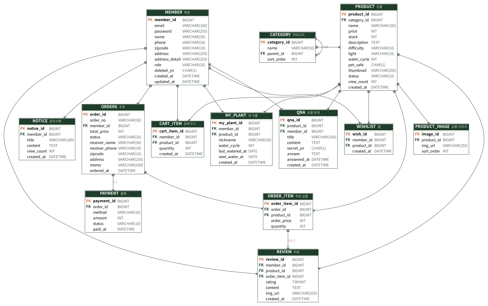

# 🌿 그린박스 GreenBox — 반려식물 큐레이션 & 관리 쇼핑몰

> [프로젝트Ⅰ] Spring Framework를 활용한 쇼핑몰 제작 · 1팀 **인연준** (1인 프로젝트)

식물을 ‘사는 것’에서 끝내지 않고 ‘잘 키우는 것’까지 함께하는 쇼핑몰입니다.
키우기 난이도 · 필요 광량 · 반려동물 안전 여부로 식물을 고르고, 구매한 식물을 **내 식물**로 등록하면 다음 물주기 날짜를 D-day로 알려 줍니다.

## 기술 스택

| 구분 | 사용 기술 |
|---|---|
| Backend | Java 17, Spring Boot 3.4, Spring Data JPA, Spring Security, Bean Validation |
| Frontend | Thymeleaf, HTML5 / CSS3, JavaScript (Fetch API) |
| Database | MySQL 8.0 (운영) · H2 (로컬 개발, MySQL 모드) |
| Build / Tool | Gradle, IntelliJ IDEA, Git · GitHub |

## 실행 방법

```bash
# 1) 로컬 실행 (DB 설치 불필요 - H2 메모리 DB, 기본 데이터 자동 생성)
./gradlew bootRun

# 2) MySQL로 실행
mysql -u root -p < docs/schema.sql          # 스키마 생성 (또는 JPA ddl-auto=update 사용)
DB_PASSWORD=비밀번호 ./gradlew bootRun --args='--spring.profiles.active=mysql'
```

접속: http://localhost:8080

| 구분 | 이메일 | 비밀번호 |
|---|---|---|
| 회원 | chorok@greenbox.com | greenbox1234 |
| 관리자 | admin@greenbox.com | admin1234 |

## 주요 기능

| 구분 | 기능 |
|---|---|
| 회원 | 회원가입(이메일 중복 확인 · BCrypt), 로그인/로그아웃(Spring Security), 회원정보 수정, 회원 탈퇴(논리 삭제) |
| 상품 | 메인(신상품 · 베스트), 카테고리 · 정렬 · 페이징, **식물 맞춤 필터**(난이도 · 광량 · 반려동물 안전), 검색, 상세(관리 가이드 · 리뷰 · Q&A 탭) |
| 쇼핑 | 찜하기(AJAX), 장바구니(수량 합산 · 변경 · 선택 삭제 · 금액 자동 계산, 3만원 이상 무료배송) |
| 주문 | 주문서(기본 배송지 불러오기), **모의 결제** — 주문 · 결제 저장과 재고 차감을 하나의 트랜잭션으로 처리, 주문 내역 · 취소(재고 복구) |
| 게시판 | 리뷰(배송완료 상품 1건당 1회, 사진 첨부), 상품 Q&A(비밀글), 공지사항 |
| **내 식물** | 구매한 식물 등록, 다음 물주기 D-day 계산, ‘물 줬어요’로 일정 재계산, 주간 물주기 일정 |
| 관리자 | 대시보드(오늘 주문 · 매출 · 재고 부족), 상품 CRUD(이미지 업로드), 주문 상태 변경, 회원 조회, Q&A 답변, 공지 관리 |

## 프로젝트 구조

```
src/main/java/com/greenbox/shop
├── config        # SecurityConfig, WebConfig, DataInitializer, GlobalModelAdvice
├── domain        # JPA 엔티티 (member, product, cart, order, board, plant)
├── dto           # 폼 · 검색 조건 · 금액 계산
├── exception     # BusinessException, 전역 예외 처리
├── repository    # Spring Data JPA Repository, 상품 필터 Specification
├── security      # UserDetails / UserDetailsService
├── service       # 비즈니스 로직 (@Transactional)
└── web           # Controller (사용자 / admin)
src/main/resources
├── templates     # Thymeleaf 화면 (fragments/layout 공통 레이아웃)
└── static        # css, js, 식물 이미지(svg)
docs              # ERD, MySQL 스키마, 설계 결과보고서
```

## ERD



13개 테이블: `member`, `category`, `product`, `product_image`, `wishlist`, `cart_item`, `orders`, `order_item`, `payment`, `review`, `qna`, `notice`, `my_plant` — 상세는 [docs/schema.sql](docs/schema.sql) 참고.

## 브랜치 전략 · 커밋 컨벤션

| 브랜치 | 용도 |
|---|---|
| `main` | 배포(제출) 버전 |
| `develop` | 기능 통합 |
| `feature/member` | 회원 · 인증 · 마이페이지 |
| `feature/product` | 상품 · 카테고리 · 필터 · 찜 |
| `feature/order` | 장바구니 · 주문 · 결제 · 내 식물 |
| `feature/admin` | 관리자 · 리뷰 · Q&A · 공지 |

- 커밋: `feat:` 기능 추가 · `fix:` 버그 수정 · `docs:` 문서 · `refactor:` 리팩터링 · `style:` 화면 · `test:` 테스트 · `chore:` 설정
- 흐름: feature 브랜치에서 작업 → develop으로 PR · 병합(`--no-ff`) → 최종본을 main에 병합
